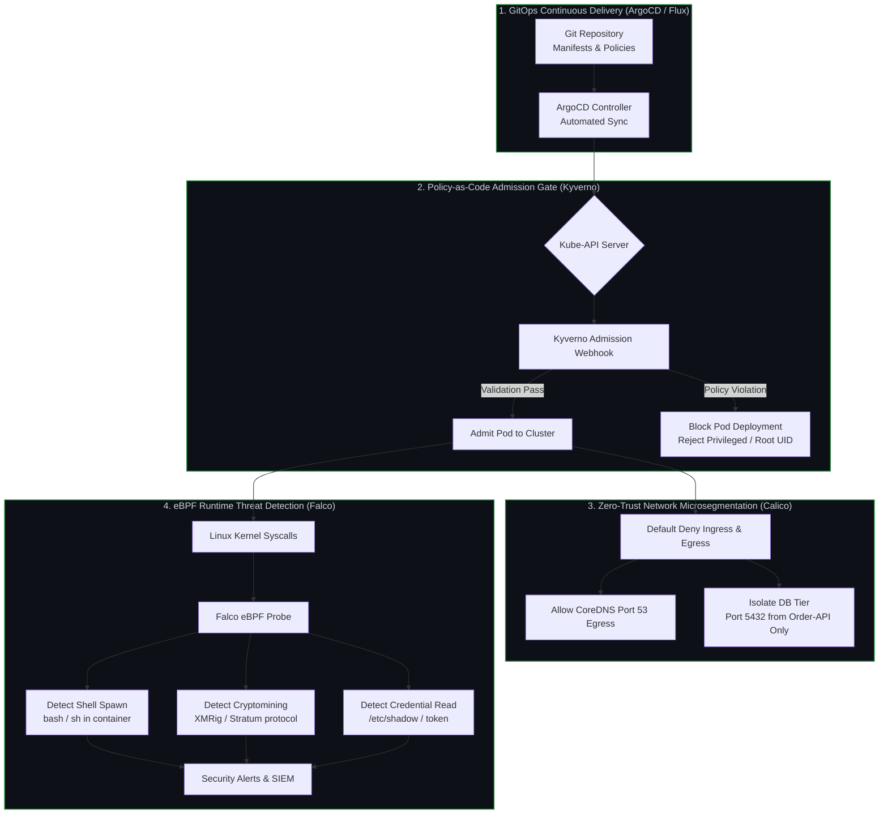

# Hardened Kubernetes GitOps Platform

[](https://github.com/huy8114644/hardened-k8s-gitops-platform/actions/workflows/policy-compliance-audit.yml)
[](https://kyverno.io)
[](https://kubernetes.io/docs/concepts/security/pod-security-standards/)
[](https://projectcalico.docs.tigera.io)
[](https://falco.org)
[](LICENSE)

Production-grade **Kubernetes Security Hardening and GitOps Architecture** implementing Zero-Trust microsegmentation, Pod Security Standards (PSS Restricted) via Kyverno Policy-as-Code, and real-time eBPF runtime threat detection using Falco.

---

## 🎯 Problem Statement & Core Value

Default Kubernetes deployments grant excessive container privileges, allow unfettered lateral network communication between pods, and lack kernel-level visibility into suspicious process executions.

This repository provides an integrated defense-in-depth security blueprint for modern cloud-native workloads:
1. **Admission Control (Kyverno):** Enforce Kubernetes PSS Restricted profile before pods are scheduled — rejecting root UIDs, hostPath volume mounts, and privilege escalation.
2. **Zero-Trust Network Microsegmentation (Calico):** Default-deny on all Ingress and Egress traffic with explicit allowlisting for DNS and database tiers.
3. **Runtime Threat Detection (Falco eBPF):** Real-time syscall monitoring detecting interactive container shells, cryptominer binaries, and sensitive credential tampering.

---

## 🏛️ Security & GitOps Architecture



---

## 🔒 Security Modules & Policy Specifications

### 1. Kyverno Policy as Code (`kyverno/policies/`)
| Policy File | Enforcement | Rule Target | Threat Mitigation |
|---|---|---|---|
| `disallow-privileged.yaml` | Enforce | `spec.containers[*].securityContext.privileged` | Prevents full node takeover and root access |
| `require-run-as-non-root.yaml` | Enforce | `runAsNonRoot: true` at Pod & Container level | Mitigates UID 0 execution vulnerabilities |
| `disallow-host-path.yaml` | Enforce | `spec.volumes[*].hostPath` | Blocks container breakouts to host filesystem |

### 2. Zero-Trust Network Policies (`network-policies/`)
| Policy File | Namespace | Scope | Traffic Rules |
|---|---|---|---|
| `default-deny-all.yaml` | `production` | All Pods | Default-deny Ingress and Egress |
| `allow-dns.yaml` | `production` | All Pods | Allow outbound UDP/TCP 53 to kube-dns |
| `database-isolation.yaml` | `production` | `tier: database` | Ingress only from `app: order-api` on 5432; 0 egress |

### 3. Falco Runtime Threat Detection (`falco/rules/`)
| Rule Name | Severity | Condition Trigger | MITRE ATT&CK |
|---|---|---|---|
| **Terminal Shell in Container** | CRITICAL | Interactive shell (`bash`, `sh`, `zsh`) spawned in pod | Execution (T1059) |
| **Sensitive File Access** | WARNING | Read of `/etc/shadow`, `/etc/sudoers`, or service token | Credential Access (T1003) |
| **Crypto-Mining Process** | CRITICAL | Execution of `xmrig`, `minerd`, `stratum` | Impact (T1496) |
| **Crypto-Mining Connection** | CRITICAL | Outbound connection to mining pool ports | Command & Control (T1071) |

---

## 🚀 Local Developer Quickstart

Standardized operational tasks are automated via the included `Makefile`:

```bash
# 1. View all available Makefile commands
make help

# 2. Lint Kubernetes manifests and policies
make lint

# 3. Run Kyverno policy test suite
make test

# 4. Scan manifests for security misconfigurations via Trivy
make scan

# 5. Validate policy schema compliance
make validate

# 6. Simulate dry-run application
make apply-dry-run
```

### Testing Policies with Kyverno CLI
```bash
# Install Kyverno CLI (if not already installed)
curl -LO https://github.com/kyverno/kyverno/releases/latest/download/kyverno-cli_linux_x86_64.tar.gz

# Validate policies directly
kyverno test kyverno/
```

---

## ☸️ GitOps Deployment with ArgoCD

```bash
# Apply Kyverno Policies to active cluster
kubectl apply -f kyverno/policies/

# Apply Zero-Trust Calico Network Policies
kubectl apply -f network-policies/

# Deploy Falco DaemonSet with custom rules
helm repo add falcosecurity https://falcosecurity.github.io/charts
helm upgrade --install falco falcosecurity/falco \
  --namespace falco --create-namespace \
  --set driver.kind=modern_ebpf \
  -f falco/rules/custom-k8s-rules.yaml
```

---

## 📄 License
This project is licensed under the MIT License - see the [LICENSE](LICENSE) file for details.
