# Hardened Kubernetes GitOps Platform

[](https://github.com/huy8114644/hardened-k8s-gitops-platform/actions/workflows/policy-compliance-audit.yml)

A Kubernetes security policy lab for reducing privileged workloads, limiting lateral network access, and reviewing runtime alerts. The repository contains three Kyverno policies, three NetworkPolicies and example Falco rules. It implements selected controls; it does not establish full PSS Restricted or CIS compliance.

## Architecture

```mermaid
flowchart LR
  PR[Pull request] --> CI[YAML validation and Kyverno fixture tests]
  CI --> Review[Review evidence and merge]
  Review --> Repo[Versioned policies]
  Repo --> DryRun[Explicit staging server dry-run]
  DryRun --> Apply[Operator-approved kubectl apply]
  Apply --> Kyverno[Kyverno admission checks]
  Apply --> Network[NetworkPolicy-capable CNI]
  Network --> Workloads[production namespace workloads]
  Workloads --> Falco[Falco custom rule examples]
  Falco -. external alert routing .-> SIEM[SIEM]
  Repo -. optional external integration .-> GitOps[Argo CD or Flux]
  GitOps -. not installed by this repo .-> Apply
```



Solid lines describe supplied configuration or documented operator steps. Dashed lines require external components. `gitops/apps/` currently contains no Argo CD application. This repository does not install a CNI, Kyverno or Falco, configure mTLS or sign images.

## Repository layout and actual coverage

| Path | Behavior and limits |
|---|---|
| `kyverno/policies/` | Deny privileged containers and hostPath volumes; check explicit non-root settings. Match rules are cluster-wide, despite messages mentioning production. Optional-field anchors do not prove every pod runs non-root. |
| `network-policies/` | Default deny in `production`, DNS egress, and database ingress from same-namespace `app=order-api` pods on TCP 5432. Policies are additive: the shared DNS allowance also applies to database pods. |
| `falco/rules/` | Example shell, sensitive-file and mining detections; these depend on Falco macros/plugins and require engine validation/tuning before activation. |
| `kyverno/tests/` | Engine-executed allowed/denied Pod fixtures. |
| `reports/` | Legacy generated sample summaries; they are not evidence of a live cluster audit. |

## Local quickstart

Requires Python 3.11+, Make and the [Kyverno CLI v1.14.4](https://github.com/kyverno/kyverno/releases/tag/v1.14.4) on `PATH`. Use a CLI binary matching your OS/architecture and verify its release checksum. No Kubernetes cluster is needed for lint or fixture tests.

```bash
make setup
make lint
make test
# Requires Trivy installed; missing tools or findings return nonzero.
make scan
```

`make lint` parses checked-in YAML and checks manifest identity/network defaults. `make test` evaluates fixtures with the real Kyverno engine. These checks do not test CNI packet forwarding or Falco kernel events. `make scan` is a separate security gate and can identify outstanding findings; no passing score is implied.

CI also runs a separate Trivy HIGH/CRITICAL gate against `network-policies/` only. Local `make scan` additionally scans `kyverno/`; the CI scan does not cover the entire policy repository.

## Configuration

There are no application environment variables. The following Make variables and manifest values control local commands:

| Setting | Default | Purpose |
|---|---|---|
| `PYTHON` | `.venv/bin/python` | YAML validation interpreter. |
| `KYVERNO`, `TRIVY`, `KUBECTL` | Tool names on PATH | Override paths to installed tools. |
| `CONTEXT` | unset, required by `make plan` | Explicit staging kubeconfig context. |
| `metadata.namespace` | `production` | Edit all NetworkPolicies together before using another namespace. |
| Labels `tier=database`, `app=order-api` | In manifests | Must match intended workloads; labels are not identities. |

## Staging plan, deployment and rollback

Use a disposable cluster with a NetworkPolicy-enforcing CNI (Calico/Cilium), compatible Kyverno CRDs/controllers, the `production` namespace, and out-of-band administrator access. Kubernetes default kind networking does not enforce NetworkPolicy. Review cluster-wide admission impact and additive network rules first.

```bash
# No resources are changed. Server-side validation contacts this context.
make plan CONTEXT=staging
# Explicit application after review; not invoked by any Make target.
kubectl --context staging apply -f kyverno/policies/
kubectl --context staging apply -f network-policies/
```

Test permitted API-to-database traffic, denied traffic and DNS in staging. Mount the Falco files through your installed chart's `customRules` configuration after validating them against the same Falco version; these rule lists are not Helm values files. Configure alert routing separately.

For rollback, apply previously reviewed manifests from a known commit, then verify connectivity and admission behavior again. Deleting NetworkPolicies can reopen traffic; deleting Kyverno policies can relax cluster-wide admission. Do not use blanket deletion as routine rollback.

## Contribution and review evidence

See [CONTRIBUTING.md](CONTRIBUTING.md) and the PR template. Use Conventional Commits, include positive/negative fixture evidence and link the CI run for the exact proposed commit. GitHub PRs preserve review discussion and pipeline links; do not treat old generated reports as validation.

MIT licensed; see [LICENSE](LICENSE).
